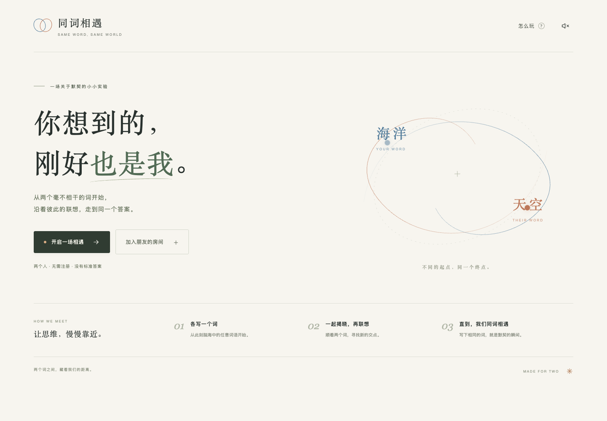

# 同词相遇

**两个人，两个词，一次思维的相遇。**

手机优先的双人在线词语联想游戏。暖白纸感、中文衬线排版、蓝与橘的思维轨迹，以及最后两个轨道交会的动画。没有倒计时，没有 AI 评判：直到两个人在同一轮写下相同的词。

前端：原生 JavaScript + CSS + Vite。后端：Supabase Auth / PostgreSQL / Realtime。托管：GitHub Pages。无需自建服务器，无需付费云函数。

> 当前交付包含完整源码、数据库迁移、安全规则、自动部署及真实 SQL / 双浏览器测试。**未提供 Supabase 项目配置时，生产联机尚不能启用。** 本地测试使用真正的 PostgreSQL（PGlite）及测试专用 HTTP 适配器，并不意味着 Supabase Cloud 或 GitHub Pages 已通过验收。实际交付状态见 [VERIFICATION.md](VERIFICATION.md)。



## 先完成这 3 件事，获得可分享的网址

### 1. 创建免费的 Supabase 项目

1. 打开 [Supabase Dashboard](https://supabase.com/dashboard)，创建组织和 **Free** 项目。数据库密码只在控制台设置并自行保管，不要放到代码或发给聊天。
2. 在 **Authentication → Sign In / Providers → Anonymous Sign-Ins** 开启 **Allow anonymous sign-ins** 并保存。控制台版本不同可能显示为 Authentication → Providers → Anonymous。
3. 打开 **SQL Editor → New query**，完整粘贴 [supabase/schema.sql](supabase/schema.sql) 并执行一次。必须使用全新项目，或确认没有同名的 `game_rooms` / `game_*` 函数；迁移不覆盖已有表，也不要在已有游戏数据库重复执行。
4. 在 **Database → Publications → supabase_realtime** 检查 `public.game_rooms` 已启用。迁移会自动将其加入现有的 publication。**绝不要发布或开放 `private.game_guesses`。**
5. 在项目的 **Connect / Project Settings → API / API Keys** 复制 **Project URL** 和 **publishable key**（`sb_publishable_…`）。旧版 **anon public** JWT 也可以。
6. 保持 API 暴露 schema 为默认的 `public`，**不要加入 `private`**。无需 Storage、Edge Functions 或额外 Auth 回调；匿名登录不使用 OAuth redirect。

这些是可公开的客户端连接参数。权限由用户 JWT、RLS 与数据库函数控制，公钥不是管理员密码。**禁止使用 `service_role`、`sb_secret_…`、数据库连接串或管理员密钥。**

官方说明：[匿名登录](https://supabase.com/docs/guides/auth/auth-anonymous)、[RLS](https://supabase.com/docs/guides/database/postgres/row-level-security)、[Postgres Changes](https://supabase.com/docs/guides/realtime/postgres-changes)。

### 2. 配置 GitHub 仓库

目标仓库：[haogegegonghao-cam/Samewordgame](https://github.com/haogegegonghao-cam/Samewordgame)。

1. 确认本工程文件已在仓库 `main` 分支。
2. **Settings → Secrets and variables → Actions → Variables → New repository variable** 添加：

   | 名称 | 值 |
   | --- | --- |
   | `VITE_SUPABASE_URL` | `https://你的项目标识.supabase.co` |
   | `VITE_SUPABASE_PUBLISHABLE_KEY` | `sb_publishable_…` 或 legacy anon public key |

3. **Settings → Pages → Build and deployment → Source** 选择 **GitHub Actions**。GitHub Free 使用公开仓库；私有仓库的 Pages 可用性取决于 GitHub 计划。
4. 在 **Actions → Deploy 同词相遇 to GitHub Pages → Run workflow** 选择 `main`。之后每次推送 `main` 都会自动测试、构建并部署。
5. 配置缺失或检测到管理员密钥时，工作流会主动失败并解释原因，不会发布一个假装能联机的版本。
6. 成功后 Pages 显示实际地址，预计为 `https://haogegegonghao-cam.github.io/Samewordgame/`，**以成功部署输出的 `page_url` 为准**。

说明：[GitHub Pages 自定义工作流](https://docs.github.com/en/pages/getting-started-with-github-pages/using-custom-workflows-with-github-pages)。本项目资源路径为相对路径，兼容仓库子目录，不需要路由重写。

### 3. 验收真实云端双人联机

1. A 在普通浏览器打开实际 Pages 地址，创建房间并复制邀请链接。
2. B 用另一台手机、另一款浏览器或隐私窗口打开邀请。**同一浏览器的普通标签页共享匿名身份，不算独立玩家。**
3. A 写「海洋」，确认 B 无法看到。A 刷新后仍显示已锁定。
4. B 写「天空」，两端均揭晓。两端点击「继续联想」。
5. 下一轮分别写「雪」与「雪」，两端出现相遇动画和完整历史。
6. 双方点击再来一局，确认从第 1 轮重新开始；断网恢复、第三窗口拒绝加入、离开关闭双方房间也需检查。

提供云端配置后也可自动运行 `E2E_URL=https://实际网址/ pnpm test:e2e`。这会创建 3 个匿名测试身份和房间，测试结束关闭房间。初次运行受匿名登录 IP 限流约束；该测试要求浏览器可访问目标服务。

## 本地运行

需要 Node.js 22+ 和 pnpm 11.25.0（可用 `npm install -g pnpm@11.25.0` 安装）。

```bash
pnpm install --frozen-lockfile
cp .env.example .env.local
# 编辑 .env.local，填入 Project URL 和 publishable/anon 公钥
pnpm dev
```

打开终端显示的本地地址。用两款浏览器或普通／隐私窗口测试。跨设备必须部署 HTTPS 网页并连接真实 Supabase；不能把 `localhost` 链接发给另一台设备。

```bash
pnpm test       # 使用真实 PostgreSQL 引擎执行迁移、RLS 和状态机验证
pnpm build      # 生成 dist/，只包含前端静态资源
pnpm preview    # 检查生产构建
```

没有云端账户也可以验证完整本地流程：

```bash
pnpm dev:test                     # 终端 1：前端 4173 / 测试 API 4174
pnpm exec playwright install chromium
PLAYWRIGHT_CHANNEL=chromium pnpm test:e2e  # 终端 2
```

本机装有 Chrome 时可直接 `pnpm test:e2e`。测试服务仅监听 `127.0.0.1`，**不得部署到公网**。它使用 SQL 中同一套生产函数和权限规则，但以测试身份替代托管 Auth，以 4 秒轮询替代云端 WebSocket。它不会被打进 `dist/`，生产前端没有演示后门。截图与报告位于 `test-results/`。

## 游戏规则与状态机

```text
waiting ──第二位玩家加入──> thinking
thinking ──第一人提交──> thinking（仅提交标记变化，词不公开）
thinking ──第二人提交──> reveal / won（同一事务写入双方历史）
reveal ──双方确认──> thinking（下一轮）
won ──双方确认再来──> thinking（新一局、第 1 轮）
任意有效状态 ──任一成员明确离开──> closed
```

- 相同的定义：NFKC 标准化；首尾空白删除、连续 Unicode 空白压为一个空格；**区分大小写，不折叠近义词或简繁体**。规则在客户端和数据库双重执行。
- 每词最多 24 个 Unicode 码点；不允许不可见控制、方向控制或零宽字符。空格不会被全部删除：`白 云` 与 `白云` 不同。
- 每局最多 50 轮，达到上限后可双方确认从头开始，避免无限增长的 Realtime 消息与分享图片。
- 房间码 10 位，排除易混淆字符，约 49 位随机熵；邀请链接只包含码，不含登录凭证。
- 24 小时有效；关标签或刷新**不会**退出，登录与房间 ID 保留在本机。明确点「结束并离开」才会关闭双方房间。
- 匿名身份存在浏览器本地。清缓存、退出匿名登录或换设备将无法取回原席位；房间不会为了恢复而放宽权限。
- 状态由数据库唯一决定。客户端不推算胜利、不主动写表、不相信 URL 里的身份。

## 安全与同步

### 真正的提交保密

`private.game_guesses` 既不开放 API schema，也撤销了 `anon` / `authenticated` 的 schema、table、function 访问权限，并启用无读取策略的 RLS。玩家连自己的未揭晓词都无法从 API 取回。公开的成员表 `public.game_rooms` 在揭晓前只含提交布尔值，**不含词语、可猜测的哈希或密文**。单一成员不能读出对手的词，也没有可执行的“提前揭晓”RPC。

第二人提交时，`game_submit` 在行锁保护的单一事务中：检查成员及局号／轮次 → 写入私有词 → 检查双人提交 → 比较词语 → 把两个词一起放进公开历史。第一人的 RPC／Realtime 事件不会意外返回第二人的秘密。只有房间成员可以读取已经揭晓的历史。

### 事务和权限

- 全部修改经过 `SECURITY DEFINER` 函数；固定空 `search_path`，完全限定对象名，只向已认证用户授予所需 RPC 权限，辅助函数不能从客户端调用。
- `SELECT … FOR UPDATE` 串行化加入、提交、下一轮、重开与离开，数据库唯一约束阻止第三席位和重复提交记录。
- 请求包含 `game` + `round`。旧请求不能影响新一轮；相同提交可幂等重试，不同词的重复提交会被拒绝。
- 两人准备好后才推进；刷新和网络重试不会自动表达“准备”。
- Realtime 只发布已净化的房间表；RLS 仅允许 `host_id` / `guest_id` 匹配的身份读取。其他用户无法枚举房间、修改表或订阅房间数据。
- 离开后不复用席位；不允许第三人继承历史。房间到期所有 RPC 与 RLS 读取均拒绝。
- 创建请求按用户加事务锁、自动恢复其未关闭的房间，每用户每小时最多创建 12 个房间。
- 实时订阅触发权威快照同步；每 4 秒轮询兜底，20 秒心跳，约 55 秒后显示对方离线。后台标签页暂停轮询；返回前台立即同步。失败提交不会用前端乐观状态伪造成功。
- 所有用户词语都 HTML 转义，分享卡用 Canvas 文本渲染，防止插入 HTML。

## 免费套餐与日常维护

Supabase [Free 计划](https://supabase.com/pricing)当前有数据库、认证和 Realtime 免费额度；闲置项目可能在一周不活跃后暂停，需要到控制台恢复。额度、地域可达性和服务状态以官方为准，不能保证永久免费可用或零延迟。

本项目面向朋友间分享，未内置验证码。Supabase 匿名登录有 IP 限流；对完全公开的大流量站点，应先接入 CAPTCHA / Turnstile、检查 Auth 限额和使用量。验证码需要在前端传 `captchaToken`，不是只打开控制台开关。本版本没有声称已实现它。

定期在 SQL Editor 执行 [supabase/maintenance.sql](supabase/maintenance.sql) 删除过期房间及其私有提交。到期记录在删除前也不可被客户端读取。匿名 Auth 用户不自动清理，维护文件附有可选清理命令；执行前理解它会注销旧匿名身份。管理员控制台和数据库备份属于服务运营者信任边界。

## 产品与无障碍

- 一次输入 + Enter／箭头提交，手机使用发送键；保留未提交草稿与同步时的光标位置。
- 等待、双方锁定、揭晓、准备、相遇与离线状态有文字提示，不只靠颜色。
- 默认静音，右上角开关启用轻微合成音效，无音频资源下载。
- 使用系统中文字体，无远程字体或图片依赖；首屏资源小，GitHub Pages 子路径可用。
- 键盘可操作、明显焦点、表单标签、错误提示、原生焦点锁定对话框、`prefers-reduced-motion` 动画降级。
- 相遇后分享文字轨迹或下载 PNG 卡片；不上传历史到第三方分享图服务。

## 项目结构

```text
src/main.js               页面、交互、状态恢复、声音、结果卡片
src/style.css            中文排版、响应式布局、轨道与相遇动画
src/api.js               匿名 Auth、RPC、Realtime、错误映射
src/words.js             Unicode/空白规则与 HTML 转义
supabase/schema.sql      数据表、RLS、私有提交、原子状态机、权限
supabase/maintenance.sql  可选清理
scripts/check-config.mjs  部署配置与公钥校验
.github/workflows/        GitHub Pages 自动部署、PR 集成测试
 tests/database.mjs       PGlite PostgreSQL 与用户权限测试辅助
 tests/game.test.mjs      安全与状态机测试
 tests/local-server.mjs   仅用于本地验证的 Supabase 兼容 HTTP 适配器
 tests/e2e.mjs            三个隔离会话、手机布局、重连、全流程验收
```

MIT License.
